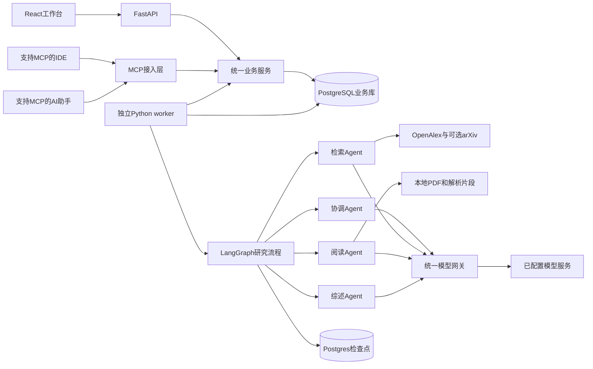
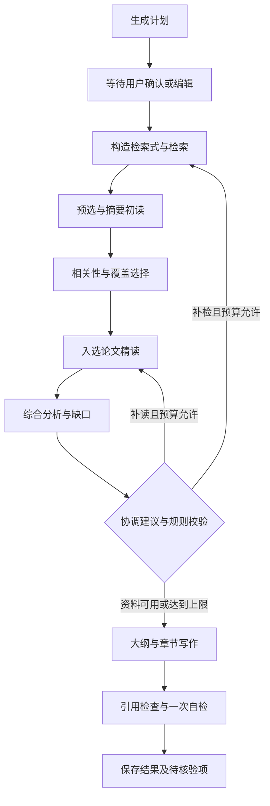

# 学术调研多 Agent 工作台：详细实施方案 Implementation Plan

> **For agentic workers:** 后续执行本计划时使用 superpowers:executing-plans。只有用户明确选择代理分工开发后才采用 superpowers:subagent-driven-development。任务使用复选框记录真实完成状态，不自动提交或推送代码。

**Goal:** 从零实现一个面向研究生和高校科研人员的四 Agent 工作台，在可控资源下完成论文检索、摘要筛选、按需精读和带原文依据的综述生成。

**Architecture:** FastAPI REST接口与MCP接入层复用统一业务服务；独立Python worker用LangGraph组织协调、检索、阅读、综述四类Agent；PostgreSQL存储业务状态和检查点，本地文件目录存储PDF。先使用论文原始摘要分层筛选，再对入选论文获取全文；网页与支持MCP的客户端访问同一项目、任务和成果。

**Tech Stack:** uv管理的Python 3.12、FastAPI、MCP官方Python SDK 2.x、Pydantic 2、LangGraph、SQLAlchemy 2、psycopg 3、PostgreSQL 16、httpx、pdfplumber；前端React、TypeScript、Vite、TanStack Query；测试pytest、Vitest、Playwright。默认本机开发，Docker为可选交付路径。

**Spec:** [已确认设计](../specs/2026-10-29-academic-research-workbench-design.md)；[原实施与验收计划](2026-10-29-academic-research-workbench.md)。

版本：v0.2，2026-10-30。四类Agent、分层阅读方案及MCP跨客户端接入已获用户确认；其他技术细节为实施建议。文档完成不表示应用已实现或全部命令已在本机通过。

实施已启动；逐模块完成状态、测试结果与环境差异以[实施记录](../../implementation/progress.md)为准。下方复选框保留原计划粒度，不因某个子功能实现就整体勾选。

## 阅读顺序与配套文件

1. 先阅读本文第1—5节，了解边界、架构、文件分工与执行顺序。
2. 跟随 [uv 本机开发指南](../../implementation/uv-development-guide.md)完成解释器、依赖、数据库和前端环境。
3. 每进入一个 Agent 任务，对照 [资料契约、算法与提示词](../../implementation/agent-contracts-and-prompts.md)实现接口。
4. 按本文T01—T12顺序编写、验证和集成，其中T09之后新增T09B；MCP接口与跨客户端验收详见[MCP接入实施附录](../../implementation/mcp-integration-guide.md)。
5. 需要全容器开发或部署时，使用[可选 Docker 操作手册](../../implementation/environment-and-operations.md)。不必为了使用 Python 3.12 而使用容器。

所有业务代码路径均相对项目根目录。PowerShell 命令的执行目录会明确标出。原有两份文档保持不变；本方案提供具体实现细节。

## Global Constraints

- 使用协调、检索、阅读、综述四类 Agent。
- 摘要初读先于全文精读；不提前全文处理全部候选论文。
- 综合分析能力合并到综述 Agent，首版不设置独立研究审校 Agent。
- 原文未报告的字段明确标记缺失；仅摘要材料不能生成全文层面的实验判断。
- 补检与修订有轮次、时间和调用预算上限。
- 不主动执行 git commit、git push；不批量删除文件；保留用户已有改动。
- API Key、Token、服务基础URL、文件存储位置通过配置读取，不写入业务函数。
- REST与MCP共用业务服务、项目、预算、幂等和版本规则；客户端连接与聊天历史不作为研究任务的持久化状态。
- 当前任务交付文档；安装依赖、运行研究和模型消费属于后续实施动作。

## Review Focus

| 场景 | 必须保证的行为 | 对应任务 |
| --- | --- | --- |
| 摘要缺失或初读预算耗尽 | 明确区分信息不足、未筛选和不相关 | T04、T05 |
| 论文重复与版本变化 | 合并重复来源，保留文档版本，旧证据仍可定位 | T04、T06 |
| 模型引用了不存在或不相干的证据 | 结构校验与语义抽查分开，错误不得变成已验证结论 | T06、T07、T12 |
| 请求完成但响应/检查点丢失 | 保留unknown调用，不能无条件重复收费请求 | T03、T08、T11 |
| worker失联、用户取消和预算用尽 | 保存部分成果，受控停止，确认旧进程退出后恢复 | T08、T09、T11 |

## 1. 首版交付范围

完成一条主路径：用户输入主题 → 查看/调整计划 → 系统找论文并筛选 → 查看精读结果 → 获取有引用的主题综述 → 查看证据与导出。

首版面向本机单用户。可以建立多个研究项目，但每项目只有一个活动 run；整个部署一个 worker，先顺序执行研究项目，单个项目内并发阅读最多3篇。这个取舍使恢复、调用预算和调试可控，后续再考虑多worker。

同一个本机用户可以从网页和至少两个实际验证过的MCP客户端访问同一后台。MCP首版通过本机Streamable HTTP提供核心工具，长任务返回run_id；断开客户端不终止已入队研究。跨客户端不扩展为多人账户，也不自动共享客户端各自的聊天记录。

用户界面至少支持：项目列表、主题与范围输入、研究计划、候选论文列表、筛选理由、精读卡片、任务进度、证据查看、综述阅读、失败重试、取消和Markdown导出。

首版不实现多人权限、付费计费系统、自动订阅、大型知识图谱、OCR流水线、独立审校Agent和完整系统综述审计。用户上传PDF保留入口，原型优先处理有文字层的英文论文，中文用于交互与生成内容。

### 1.1 一次正常研究的建议默认值

| 项目 | 起始值 | 为什么与如何调整 |
| --- | --- | --- |
| 候选论文 | 最多200篇去重记录 | 先验证小规模候选池；原始命中数另外记录 |
| 摘要初读 | 最多60篇 | 通过每问题候选覆盖和词面排序预选，不全量调用模型 |
| 全文精读 | 最多20篇 | 可少于20篇，不能凑数；用户指定计入配额 |
| 单篇片段 | 最多12个、目标700 token/段 | 大文档按问题定向精读，明确披露未覆盖章节 |
| 阅读并发 | 3 | 控制限流与内存；不得让每个角色再独立扩大并发 |
| 来源请求 | 最多20次/运行 | 包括分页、重试和补检；命中后缓存 |
| 模型调用 | 最多150次/运行 | 每次重试也计数 |
| 估算总token | 400000 | 估算预算，不等同于供应商实际账单硬上限 |
| 研究时长 | 1200秒 | 超时停止安排新任务，保存进行中的调用状态 |
| 补充研究 | 最多1轮 | 避免多Agent无限搜索 |
| 综述修订 | 最多1轮 | 后续由用户显式发起新的修订任务 |

所有值写配置和run快照，不散落到循环中。工程硬约束与估算分开：调用次数和配额可严格限制；token/费用只有在供应商计数和预留可靠时才可精确约束。

## 2. 技术选型及取舍

| 组件 | 采用方案 | 本项目中的职责 | 首版取舍 |
| --- | --- | --- | --- |
| Python管理 | uv + 项目Python3.12 + uv.lock | 安装解释器、隔离环境、锁定依赖 | 不依赖本机Conda或系统Python版本 |
| API | FastAPI + Pydantic2 | 参数校验、OpenAPI、资料查询 | 长研究不在请求线程里完成 |
| 跨客户端接入 | 官方MCP Python SDK 2.x + 本机Streamable HTTP | 工具发现、受控研究操作、成果读取 | 一个MCP服务复用业务层；首版不要求内部Agent经MCP互调 |
| Agent编排 | LangGraph StateGraph | 可检查的阶段、分支、检查点 | 采用有边界的图，不开放自由Agent群聊 |
| 模型适配 | ModelGateway + ChatOpenAI适配器 + mock | 角色模型配置、结构化输出、用量 | 服务商不固定；通过能力探测填真实模型ID |
| 存储 | PostgreSQL16 + SQLAlchemy2 + Alembic | 资料关系、任务队列、版本与账本 | 暂不引入Redis、Celery或独立向量库 |
| 论文数据 | OpenAlex主源；arXiv按学科启用 | 元数据与原始摘要 | 不能把arXiv当成所有学科的完整备用源 |
| PDF | pdfplumber；GROBID可选 | 文字、页码、原文位置 | 扫描件标异常，暂不自动OCR |
| 片段检索 | BM25 + 章节/问题覆盖规则 | 候选预选、正文定向阅读 | 首版无需嵌入模型或GPU |
| 前端 | React + TypeScript + Vite | 研究工作台 | 保持单页应用，方便本地演示 |
| 服务端状态 | TanStack Query | 请求、轮询和失效刷新 | 不把服务器进度复制成多个独立本地状态 |
| 测试 | pytest/respx、Vitest、Playwright | 算法、接口、失败恢复和页面流程 | 默认mock；真实服务测试显式开启 |

LangGraph持久化和FastAPI长任务的依据分别见[持久化文档](https://docs.langchain.com/oss/python/langgraph/add-memory)与[BackgroundTasks说明](https://fastapi.tiangolo.com/tutorial/background-tasks/)。本项目的独立worker是工程选择，不要求使用某个托管Agent平台。

## 3. 组件关系与资料流



API在短事务里创建run并返回202；worker领取任务后执行图。前端轮询run和事件；关闭浏览器不终止研究。数据库负责真实状态，前端不根据计时器假装进度增长。

LangGraph state只放run_id、plan_id、artifact_id、当前阶段、路由选择等小型引用。整篇PDF、长摘要列表和全部聊天历史不存进state，避免每个检查点重复保存大量内容。

## 4. 目标目录与模块边界

```text
项目根目录/
  README.md
  .env.example
  .gitignore
  compose.db.yaml                         # 可选：只运行数据库
  compose.release.yaml                    # 后期可选：完整容器部署
  backend/
    .python-version
    pyproject.toml
    uv.lock
    alembic.ini
    migrations/
    app/
      __init__.py
      main.py                             # FastAPI应用与生命周期
      serve.py                            # 本机API运行入口
      runtime.py                          # Windows事件循环适配
      config.py                           # 配置读取、路径与URL构造
      cli.py                              # doctor、迁移辅助、实验入口
      schemas/contracts.py                # Agent与资料契约
      schemas/api.py                      # HTTP请求与响应模型
      db/session.py                       # engine和session factory
      db/models_projects.py               # projects、plans、runs
      db/models_papers.py                  # papers、sources、documents、chunks
      db/models_artifacts.py               # evidence、artifacts
      db/models_tasks.py                   # tasks、model_calls、events
      repositories/projects.py
      repositories/papers.py
      repositories/artifacts.py
      repositories/tasks.py
      llm/base.py                         # ModelGateway与ModelResult
      llm/mock.py
      llm/openai_compatible.py
      llm/budget.py
      agents/context.py
      agents/coordinator.py
      agents/retrieval.py
      agents/reading.py
      agents/review.py
      services/projects.py                # 项目查询与版本边界
      services/research.py                # 研究创建、确认、取消、进度
      services/literature.py              # 受控检索与论文详情
      services/results.py                 # 综述、证据与导出
      mcp_gateway/server.py               # SDK装配及ASGI生命周期
      mcp_gateway/tools.py                # 工具到业务服务的薄映射
      mcp_gateway/resources.py            # 可选只读资源映射
      mcp_gateway/schemas.py               # MCP入参、结果封装和契约版本
      sources/base.py
      sources/mock.py                     # 原创来源fixture，默认不联网
      sources/openalex.py
      sources/arxiv.py
      sources/normalize.py
      sources/rate_limit.py
      screening/preselect.py
      screening/select.py
      documents/download.py
      documents/parse.py
      documents/chunk.py
      documents/evidence.py
      review/assemble.py
      review/validate.py
      review/export.py
      workflow/state.py
      workflow/graph.py
      workflow/nodes.py
      workflow/recovery.py
      worker/main.py
      worker/claim.py
      api/projects.py
      api/runs.py
      api/papers.py
      api/reviews.py
      api/errors.py
      evaluation/runner.py
      evaluation/metrics.py
      evaluation/export.py
    prompts/                              # 8个角色/步骤模板
    fixtures/                             # 原创或可用的固定样本
    tests/unit/
    tests/integration/
    tests/live/
  frontend/
    package.json
    package-lock.json
    vite.config.ts
    vitest.config.ts
    playwright.config.ts
    src/api/client.ts
    src/api/schema.d.ts                    # 从OpenAPI生成
    src/features/projects/
    src/features/research/
    src/features/papers/
    src/features/reviews/
    src/components/
    tests/e2e/
  evals/
    dataset.schema.json
    benchmark.dev.jsonl
    benchmark.test.jsonl
    configs/
  docs/
```

模块依赖方向：REST/MCP → services → repositories或后台任务；worker/研究图 → services/agents → repositories/adapters。schemas不导入数据库；来源适配器不直接写综述；前端不直接调用模型服务。MCP不通过回环HTTP再调用自己的REST接口，内部Agent也不为每次服务调用绕行MCP。

## 5. 实施顺序与阶段交付

| 阶段 | 任务 | 结束时应该能演示什么 |
| --- | --- | --- |
| 基础 | T01—T03 | uv环境、数据库、模型mock/探测和预算账本 |
| 文献处理 | T04—T06 | 找论文、给筛选理由、只精读入选论文并定位证据 |
| 研究协作 | T07—T08 | 生成综述，必要时补检，任务能够暂停/恢复 |
| 接入与界面 | T09 → T09B → T10 | 网页及MCP客户端访问同一研究和成果 |
| 交付评价 | T11—T12 | 故障演练、真实小样本联调、实验与部署资料 |

每个开发任务采用同一节奏：写一个有意义的失败用例 → 执行确认失败原因 → 实现最小逻辑 → 再执行验证 → 保存对应说明。不能以“导入不报错”替代业务验收。

以下测试命令是目标命令；当前仓库还没有这些测试文件。首次依赖锁定后验证命令可用，之后以锁文件重现。

## T01. 建立可运行骨架和统一配置

**文件：** README.md、.env.example、.gitignore；backend/pyproject.toml、app/main.py、app/config.py、app/runtime.py、app/serve.py；tests/unit/test_config.py、tests/unit/test_runtime.py、tests/unit/test_health.py。

**输入：** 项目目录与配置模板。**输出接口：** `get_settings() -> Settings`、`run_async(coro)`、FastAPI `app`、`GET /api/health/live`。

- [ ] 按uv指南建立Python3.12与锁文件。先实现最小health接口，再加入其他模块。
- [ ] 用Pydantic Settings声明所有环境字段。根据 config.py 所在位置推导项目根目录，明确读取根目录.env；使用环境变量覆盖文件配置。
- [ ] 模型mock模式允许密钥为空；live模式要求API密钥、URL和模型ID完整。错误只报告缺失字段名称，不输出SecretStr内容。
- [ ] 将相对STORAGE_ROOT解析到项目根目录，创建documents、parsed、exports子目录。存储路径由程序生成，不能接受用户任意路径。
- [ ] DB连接用SQLAlchemy URL.create构造，checkpointer用psycopg.conninfo.make_conninfo构造，避免密码中的@、%和冒号破坏连接串。
- [ ] API、CLI、worker均使用uv指南中的统一事件循环入口。
- [ ] README记录执行位置、初始化和启动命令，不使用本机全局pip安装。

**测试先行：** mock模式缺密钥能加载；live模式缺配置失败；密码含特殊字符能正确构造DSN；相对存储路径不随终端目录变化；Windows事件循环为Selector。

```powershell
uv run --locked pytest tests/unit/test_config.py tests/unit/test_runtime.py tests/unit/test_health.py -q
```

**完成标准：** backend/.venv内Python3.12可运行API，health返回200；没有调用真实模型；密钥不会进入错误响应。

## T02. 数据库、资料版本与迁移

**文件：** app/db/下4组模型与session.py；app/repositories/；migrations/；app/cli.py；tests/integration/test_repositories.py、test_migrations.py。

**输入：** [资料契约附录](../../implementation/agent-contracts-and-prompts.md)的13张业务表。**输出接口：** `session_factory()`；`ProjectRepository.create()`、`PaperRepository.upsert_source()`、`ArtifactRepository.get_or_create(operation_key, payload)`。

- [ ] 安装PostgreSQL并分别建立research和research_test；不要拿SQLite替代集成测试，因为JSONB、锁和部分索引语义不同。
- [ ] 写ORM模型与关联约束，完成Alembic初始化、env.py和首个迁移；审阅生成SQL。
- [ ] runs采用queued/running/waiting_user/interrupted/completed/partial/failed/cancelled状态。创建“每项目一个非终态run”的部分唯一索引。
- [ ] sources保存原始数据；artifact追加写入并保存schema_version与input_hash。禁止原地覆盖用户编辑。
- [ ] 为每次数据库操作限定短事务。并发阅读每个协程使用自己的AsyncSession，不共享session。
- [ ] 预留MCP客户端提交任务的任务幂等字段，定义见接入附录；业务层统一处理网页与MCP并发请求，不能为客户端另建独立预算。
- [ ] 实现CLI init-checkpoints和doctor。准备数据库、存储与配置检查结果，输出结构化状态。
- [ ] 实现prepare-test-db，确认数据库名为配置派生的_test库，再执行测试库迁移；不自动给应用用户增加管理权限。

**测试先行：** 同一operation_key重复提交只产生一个artifact；同项目并发创建run只有一个成功；source重复写保留唯一性；两个版本文档能并存；事务失败没有半条资料。

```powershell
uv run --locked python -m app.cli prepare-test-db
uv run --locked pytest tests/integration/test_repositories.py tests/integration/test_migrations.py -q
```

**完成标准：** 可创建项目、论文和有版本的资料，迁移可以在空测试库重现；checkpoint表与业务ORM迁移分开管理。[SQLAlchemy并发会话约束](https://docs.sqlalchemy.org/en/20/orm/extensions/asyncio.html)

## T03. 模型网关、mock与预算账本

**文件：** app/llm/base.py、mock.py、openai_compatible.py、budget.py；app/agents/context.py；app/cli.py；fixtures/model/；tests/unit/test_model_gateway.py；tests/integration/test_budget.py。

**接口：** `ModelGateway.generate(schema, messages, profile, call_context) -> ModelResult[T]`；`reserve_call(run_id, operation_key, estimate) -> Reservation`；`settle_call(call_id, usage, artifact_id)`。

- [ ] 定义ModelResult：parsed值、provider_request_id、输入/输出token可空、finish_reason、raw_error、model_snapshot。不要让下游依赖某服务商的响应字典。
- [ ] 先实现MockModelGateway，根据operation与fixture_key返回固定结果；包含合法输出、无效JSON、拒绝、截断、超时和冲突证据样本。
- [ ] 再实现live适配器，读取screen/research两个配置profile。原生schema、function_calling、json_prompt分别有能力检测结果，不能假设任意兼容端点都支持。
- [ ] 实现probe-model CLI，用一个小型schema探测；测试结果记录到本地诊断文件，不在默认单元测试中运行。
- [ ] 所有模型调用先预留预算再发请求。锁定run预算行，核对used+reserved+本次估算，写model_calls，然后提交事务，最后执行网络调用。
- [ ] 成功后在同一事务结算实际用量并关联结果；结果缺少用量则usage_unknown。调用次数仍计入used_calls，未知token预留仍保留。SDK自动重试关闭，显式重试每次有新attempt与预留。
- [ ] 响应丢失或调用结果不确定时保留unknown与预留，不把未知费用记为0。只有能确认没有执行或完成对账后才释放。
- [ ] 统一错误码MODEL_SCHEMA_INVALID、MODEL_REFUSED、MODEL_TRUNCATED、MODEL_RATE_LIMITED、MODEL_TIMEOUT_UNKNOWN和BUDGET_EXHAUSTED。

**预算边界：** 供应商不支持幂等或请求查询时，不能保证外部请求绝不重复收费。系统可保证本地不会重复结算同一调用，并在不确定状态下停止自动重试。金额预算只有配置了价格版本与完整用量时才启用；其余情况下展示token估算和调用次数。

**测试先行：** 余额不足不会触发HTTP；三个并发预留不超调用上限；schema修复仅一次；unknown不释放预留；重复结算不重复扣账；日志不含密钥。

```powershell
uv run --locked pytest tests/unit/test_model_gateway.py tests/integration/test_budget.py -q
```

**完成标准：** 全流程可以无密钥mock运行，live接入有明确探测与失败解释，调用数和错误能按run查询。

## T04. 协调规划、查询生成与论文检索

**文件：** agents/coordinator.py、agents/retrieval.py；sources/base.py、mock.py、openalex.py、arxiv.py、normalize.py、rate_limit.py；prompts/coordinator_plan.j2、retrieval_queries.j2；tests/unit/test_sources.py、test_normalize.py、test_planning.py。

**接口：** `CoordinatorAgent.plan(request, context) -> PlanDraft`；`RetrievalAgent.formulate_queries(plan, context) -> QueryPlan`；`PaperSource.search(query, cursor, limit) -> SearchPage`。

- [ ] 协调Agent将主题拆成3—5个子问题，给英文检索术语；保存用户范围与系统建议的来源区别。
- [ ] 给每个数据源声明能力：可用学科、筛选字段、分页模式、速率限制。检索Agent生成语义查询意图，适配器转换成实际参数。
- [ ] SOURCE_MODE=mock时注入MockPaperSource，只读backend/fixtures中的原创来源数据与PDF映射；live时才构造HTTP适配器。LLM_MODE与SOURCE_MODE独立控制，默认组合不联网。
- [ ] 主源OpenAlex调用 `/works`，params使用search或search.title_and_abstract、filter、per_page、cursor；查询参数由httpx编码，不能拼接未转义字符串。
- [ ] 每页最多100，优先取所需字段。需要游标续页时配置API key；没有key时停止续页并报告范围限制，不把第一页当成完整结果。
- [ ] 解析abstract_inverted_index，保留原索引和重建状态。摘要缺失返回null，不让模型填补“原摘要”。
- [ ] 可选arXiv解析Atom XML中的id、title、summary、published、updated和链接；使用defusedxml，并保留v1/v2版本。
- [ ] 所有arXiv请求共用单个调度器，最多一个并发、间隔至少3秒；不要让阅读Agent另开HTTP抓取绕开限流。
- [ ] 保存来源请求、检索式、抓取时间、返回数量、分页停止原因。按DOI/providerID/版本去重，疑似标题重复保留候选关联。
- [ ] 按子问题分配查询与候选预算。优先复用已经获取的同一查询结果，补检只执行新检索式或新范围。

当前OpenAlex基础查询可以无key，续游标需要key；接入时仍需复核账户额度。[认证](https://help.openalex.org/api/authentication/)、[分页](https://help.openalex.org/api/paging/)、[搜索](https://help.openalex.org/api/searching/)。arXiv限流以[官方使用条款](https://info.arxiv.org/help/api/tou.html)为准。

**请求示例结构：** `httpx.AsyncClient.get(settings.openalex_base_url + '/works', params=params, headers=headers)`。生产中通过来源适配器构建URL，设置连接与读取超时，隐藏Authorization日志。

**测试先行：** respx模拟分页与429；无key续页停止；API返回200但无摘要；重复DOI；arXiv版本；未知XML字段；一个来源失败仍保留其他结果；总体候选上限不因并发超出。

```powershell
uv run --locked pytest tests/unit/test_sources.py tests/unit/test_normalize.py tests/unit/test_planning.py -q
```

**完成标准：** 给一个主题得到可检查的候选集和来源记录，此时没有任何自动全文下载。

## T05. 摘要初读、相关性排序和精读选择

**文件：** agents/reading.py的screen方法；screening/preselect.py、select.py；prompts/reading_screen.j2；tests/unit/test_preselect.py、test_screening.py、test_selection.py。

**接口：** `preselect(papers, questions, limit) -> PreselectionResult`；`ReadingAgent.screen(...) -> ScreenOutput`；`select_deep_reads(cards, plan, user_choices, limit) -> SelectionResult`。

- [ ] 实现便宜的词面预选：按每个子问题分别做BM25，再轮流取候选，避免前60条都来自同一研究分支。
- [ ] 将未进入初读的论文标记not_screened_due_to_budget，不标成不相关。
- [ ] 对有原始摘要的记录调用screen；没有摘要的记录先尝试其他已配置元数据源补充，仍缺失则insufficient_info。
- [ ] 验证返回等级0—4、允许的question_id与decision之间一致。把原始摘要与模型短概括分别保存。
- [ ] 以子问题覆盖为先，再使用附录中0.65相关性+0.25新增覆盖+0.10新颖度的起步公式，选择最多20篇。
- [ ] 用户指定论文进入优先集合，但受预算约束。冲突时返回明确提示，不静默丢弃。
- [ ] 输出完整selection artifact，包含选入、未选入、待补充及原因。所有后续全文任务必须以该artifact为依据。

**测试先行：** 60条限制；无摘要不调用摘要模型；用户指定与自动排序冲突；多个子问题覆盖；全部低相关时允许少选；候选排序改变但同分时结果稳定；未选论文的download mock调用次数为0。

```powershell
uv run --locked pytest tests/unit/test_preselect.py tests/unit/test_screening.py tests/unit/test_selection.py -q
```

**完成标准：** 能回答“为什么精读这20篇、为什么其他论文没有进入”，并能证明没有提前全文阅读全部候选。

## T06. 获取全文、解析片段与原文证据

**文件：** documents/download.py、parse.py、chunk.py、evidence.py；agents/reading.py的extract方法；prompts/reading_extract.j2；tests/unit/test_documents.py、test_evidence.py；tests/integration/test_reading.py。

**接口：** `download_selected(paper, selection, context) -> DocumentResult`；`parse_pdf(path) -> ParsedDocument`；`choose_chunks(document, questions, limit) -> ChunkSelection`；`validate_evidence(candidate, chunk) -> EvidenceRecord`。

- [ ] 先验证论文已入选，或来自用户明确的精读请求。按可用公开副本逐个尝试，保留license、来源和版本；不绕过登录或付费获取限制。
- [ ] httpx流式下载，验证状态、MIME、PDF文件头和最大大小；临时文件完成后原子保存。URL来自已配置来源，禁止localhost、私网地址与任意协议；重定向也重新验证，异常停止。
- [ ] 用SHA-256判断是否已有同一文件；文件名由程序生成。失败不留下被当成完整PDF的记录。
- [ ] pdfplumber提取page_number、text、words与位置。用原创fixture覆盖单栏、双栏、空白、损坏和大页数文件。
- [ ] 解析是CPU/阻塞任务，用multiprocessing的spawn上下文启动独立Process，通过Pipe返回结构化结果，main入口加保护；一次只允许1个解析进程。父进程超时后terminate该进程并join，仍存活才kill再join；不把取消Future当成停止解析。
- [ ] 父进程用有超时的poll/recv持续接收结果，收到结果后再join，避免大结果塞满Pipe时双方等待；监督逻辑用asyncio.to_thread运行，不阻塞worker心跳。子进程只接收文件路径与解析参数，不传数据库session或模型客户端。
- [ ] 按页分段，控制大小并保留section_hint。双栏顺序异常时标记parser_warning；若启用GROBID作为增强，记录parser版本差异。
- [ ] 按子问题、章节覆盖和BM25选择最多12个片段，分批抽取。记录full_text_targeted与未读章节，不声称已完整阅读。
- [ ] 模型返回quote和chunk_id；服务端验证原文对应，再生成证据ID、字符位置、页码和可用坐标。
- [ ] 将结构化事实、作者观点、推断、缺失状态分开。仅摘要论文不参与数值实验对照，只作为明确标注的背景资料。

PDF公开可读不自动意味着可以再分发；副本许可与元数据许可分别保存。[OpenAlex全文说明](https://help.openalex.org/access/fulltext/)。pdfplumber不提供OCR，能力边界见[官方仓库](https://github.com/jsvine/pdfplumber)。

**测试先行：** 未入选不能下载；超限停止流式读取；错误PDF不进入parsed；quote不存在/多义匹配失败；页码来自parser；不同版本的旧证据不漂移；扫描件标明确状态；全文不可用返回部分结果。

```powershell
uv run --locked pytest tests/unit/test_documents.py tests/unit/test_evidence.py tests/integration/test_reading.py -q
```

**完成标准：** 点击一个事实可以定位到具体论文版本和原文；阅读范围明确，缺失全文不会产生虚构实验结论。

## T07. 综合分析、大纲、分章节写作和基础检查

**文件：** agents/review.py；review/assemble.py、validate.py、export.py；prompts/review_analyze.j2、review_section.j2、review_self_check.j2；tests/unit/test_review.py、test_citations.py、test_export.py。

**接口：** `ReviewAgent.analyze(cards, context) -> SynthesisArtifact`；`write_section(section_plan, evidence_bundle, context) -> SectionOutput`；`validate_review(review, repository) -> ValidationReport`；`export_markdown(review) -> str`。

- [ ] 为每个子问题建立“现有证据、不同方法、对比条件、缺口”的结构化表，不直接把所有摘要连接起来。
- [ ] 对照字段包括任务、研究对象/数据、方法、指标、实验设置、结果、局限和证据ID。不可比的字段标说明，不能直接排名。
- [ ] 生成并保存synthesis与outline两个artifact；大纲包含章节目标、问题ID和证据ID。
- [ ] 每次只向模型传本节需要的原文证据、卡片及术语表，按照上下文上限分批，不塞入全部研究历史。
- [ ] 章节输出为ClaimBlock数组，系统生成块ID；文献事实和综合判断必须带证据ID。
- [ ] 程序校验ID存在、项目归属、论文版本、证据关联与参考文献完整性。引用编号由程序生成，模型不得自由编造参考文献。
- [ ] 综述Agent进行一次自检，返回具体问题和建议。允许修订最多一轮；未解决项保留，不能用“自检通过”代替人工可靠性证明。
- [ ] 最终章节包括背景范围、概念、研究分支、方法比较、进展与分歧、局限/待验证方向、检索说明和参考文献。
- [ ] Markdown导出保留编号、文献身份、DOI/来源链接、证据页码、研究截止时间和覆盖局限；用户编辑另存新版本。

**测试先行：** 伪造证据ID被拒绝；跨项目证据被拒绝；相同论文多次引用编号一致；引用排序改变仍对应正确论文；引文存在但语义不支持的样本进入待核验；导出包含参考文献与范围说明。

```powershell
uv run --locked pytest tests/unit/test_review.py tests/unit/test_citations.py tests/unit/test_export.py -q
```

**完成标准：** 用固定精读卡片可生成可查阅综述，能追踪每个关键判断的原文依据，分析材料保留可检查。

## T08. 串联研究图、独立 worker、预算与恢复

**文件：** backend/app/workflow/state.py、graph.py、nodes.py、recovery.py；worker/main.py、claim.py；repositories/tasks.py；tests/unit/test_routing.py；tests/integration/test_worker.py、test_recovery.py、test_budget.py。

**接口：** `build_graph(services, checkpointer)`；`claim_next_run(worker_id) -> RunLease | None`；`execute_run(lease)`；`request_cancel(run_id)`；`recover_run(run_id, expected_claim_token)`。所有服务函数使用明确的 Pydantic/ORM 类型，类型细节见附录的接口字段表。

### T08.1 明确研究图与状态



图中的补检/补读共享 `supplement_round` 上限，不能各自循环一次后继续互相触发。每次补充仅处理新候选或尚未完成的论文；累计配额按整个 run 计算。

- [ ] 在 state.py 定义 TypedDict：run_id、plan_id、stage、selection_artifact_id、synthesis_artifact_id、review_artifact_id、supplement_round、revision_round、next_action。可空字段显式声明，不靠缺失键隐含状态。
- [ ] graph.py 注册 plan、approve_plan、retrieve、screen、select、read、analyze、decide、write、validate、finalize 节点；每个节点只调用已实现服务并返回状态增量。
- [ ] nodes.py 的每个入口检查取消、剩余预算和输入资料版本。节点退出前写好 artifact 与事件，再返回引用。
- [ ] approve_plan 采用 LangGraph `interrupt()`；用户确认后用 `Command(resume=...)` 恢复。中断节点可能重入，生成计划等有副作用操作放在它之前的独立节点。
- [ ] 用户在确认界面提交修改时生成新计划版本，验证通过后冻结 run.plan_id，再允许进入检索。正式检索之后修改范围须新建 run。
- [ ] decide 先取得 CoordinatorAgent 的建议，再由程序检查允许的动作、问题ID、轮次、剩余配额和新材料数；没有新增有效资料时直接收束，不继续消耗补检预算。
- [ ] 未解决缺口进入 coverage_report 和最终综述。没有可用证据时生成资料不足说明，不能为了走完图而生成研究结论。

**实现要点：** LangGraph 保存的是可恢复阶段，数据库 artifacts 保存业务结果，两者不能假设跨库操作天然处于同一事务。节点必须允许“结果已保存但检查点还没保存”时重入，通过 operation_key 找回已完成结果。

### T08.2 worker 怎样领取任务

在 runs 增加 available_at、created_at、started_at、finished_at、cancel_requested_at、active_elapsed_seconds、supplement_round、revision_round。后台任务队列先复用 PostgreSQL，无需额外队列服务。

短事务领取示例（实际绑定参数，不拼接 SQL）：

```sql
WITH picked AS (
    SELECT id
    FROM runs
    WHERE status = 'queued' AND available_at <= now()
    ORDER BY created_at, id
    FOR UPDATE SKIP LOCKED
    LIMIT 1
)
UPDATE runs AS r
SET status = 'running', worker_id = :worker_id,
    claim_token = :claim_token, heartbeat_at = now(),
    lease_until = now() + interval '60 seconds'
FROM picked
WHERE r.id = picked.id
RETURNING r.*;
```

- [ ] worker启动时生成 worker_id；首版通过数据库 session advisory lock 保证部署内只有一个worker调度进程，专用连接断开即停止调度，不与业务短事务混用。
- [ ] claim_next_run 每次生成新的 claim_token。事务提交后才执行网络/模型任务；网络请求期间不持有行锁。
- [ ] 每10秒更新 heartbeat_at 和60秒租约。业务结果落库时核对 run_id 与 claim_token；失去归属的执行者停止提交。
- [ ] 同一run内用 asyncio.Semaphore 限制最多3个阅读实例，每个并发任务使用独立 AsyncSession。来源限流器和预算服务是共享的，不能每实例各自放宽额度。
- [ ] 单篇失败记录到 tasks，其他已成功材料继续可用；关键基础设施失效才停止整个run。失败不能写成“论文无结果”。
- [ ] 用户确认计划期间释放worker当前任务槽；run保持waiting_user，批准后改为queued，后续用中断恢复路径继续。
- [ ] worker处理完一个run再领取下一个，空闲轮询使用短间隔和优雅退出机制。重复启动第二个worker时提示已有worker，不能并行进入同一研究图。

SKIP LOCKED 适合队列式消费；它不自动提供外部调用“恰好一次”。参考 [PostgreSQL SELECT 文档](https://www.postgresql.org/docs/16/sql-select.html)和 [SQLAlchemy 异步并发说明](https://docs.sqlalchemy.org/en/20/orm/extensions/asyncio.html)。

### T08.3 检查点、重入与中断恢复

初始化检查点表后，worker进程在生命周期内创建 saver。概念代码如下，services、initial_state、config由实际类型构造：

```python
from langgraph.checkpoint.postgres.aio import AsyncPostgresSaver
from langgraph.types import Command

async def invoke_persisted_run(dsn, services, run_id, initial_state, resume_payload=None):
    config = {"configurable": {"thread_id": str(run_id)}}
    async with AsyncPostgresSaver.from_conn_string(dsn) as saver:
        graph = build_graph(services, saver)
        checkpoint = await saver.aget_tuple(config)
        if resume_payload is not None:
            graph_input = Command(resume=resume_payload)
        elif checkpoint is None:
            graph_input = initial_state
        else:
            graph_input = None
        return await graph.ainvoke(graph_input, config, durability="sync")
```

生产实现把 saver 提升为worker生命周期资源，避免每个步骤重复建立连接。SQLAlchemy连接URL与saver使用的psycopg连接字符串分别从配置构造；不能直接把 `postgresql+psycopg://` 原样传给saver。[LangGraph检查点文档](https://docs.langchain.com/oss/python/langgraph/add-memory)

- [ ] task操作键由 run_id、操作名称、paper/document ID、输入哈希和prompt版本构成。先查询成功artifact，有则直接复用。
- [ ] 单篇阅读完成立即保存，整批节点崩溃时无需重读已完成论文。批次处理要汇总每篇独立结果，不能等20篇全部结束才一次写入。
- [ ] 故障恢复先读图状态：若图已完成且最终artifact存在，仅补齐run终态；若处于interrupt，等待有效用户输入；其他未完成状态按检查点继续。
- [ ] 租约超时仅标记“疑似中断”。管理员确认旧worker进程已退出后，才能使同一thread_id恢复运行。不得仅凭lease_until过期就启动第二执行者。
- [ ] 检查点写入不自动受业务表claim_token约束，所以首版禁止自动抢占不明状态worker。部署监督器若无法证明旧进程已退出，保持interrupted并提示处理。
- [ ] 恢复时先检查model_calls的unknown记录。可查询供应商请求状态则核对；否则保留潜在用量和待处理提示，不把它当未调用直接重发。
- [ ] 必须重试unknown请求时由用户明确选择，沿用当前run记录新增attempt与潜在重复费用；普通网络重试策略不能偷偷执行该动作。
- [ ] 若用户取消，停止新派发，已完成结果保留；在途请求尽力取消并记录最终状态或unknown。不能把前端按钮点击等同于供应商已经停止计费。

### T08.4 状态与时间预算

| run状态 | 页面表现 | 可以执行的操作 |
| --- | --- | --- |
| queued | 等待执行 | 查看、取消 |
| running | 当前阶段、已完成计数、预算 | 查看、申请取消 |
| waiting_user | 需要确认计划或处理预算冲突 | 查看、提交确认、取消 |
| interrupted | worker中断或调用状态未明 | 查看；确认旧进程停止后恢复或取消 |
| completed | 有最终综述和检查结果 | 阅读、编辑、导出、新建研究 |
| partial | 部分成果，附明确停止原因 | 阅读、导出可用部分、创建后续研究 |
| failed | 核心流程失败，保留诊断 | 查看、按可恢复条件重试 |
| cancelled | 已停止新任务，可能有部分成果 | 查看、导出已有资料 |

1200秒预算使用累计实际研究时间；用户等待确认的时间不计入。每次心跳保存累计耗时，恢复不重置预算。单次HTTP超时仍独立设置。预算阈值到达后只允许保存、校验已有内容和停止，不自动追加有费用的“最后一次写作”。若尚无综述就显示“已完成文献整理，综述未生成”。

**测试先行：** `test_claim_is_exclusive`、`test_plan_interrupt_resumes_with_edit`、`test_resume_reuses_completed_reading`、`test_expired_lease_does_not_auto_takeover`、`test_final_checkpoint_reconciles_run_status`、`test_unknown_call_is_not_automatically_retried`、`test_supplement_and_read_share_one_round`、`test_waiting_time_does_not_consume_research_budget`。

```powershell
uv run --locked pytest tests/unit/test_routing.py tests/integration/test_worker.py tests/integration/test_recovery.py tests/integration/test_budget.py -q
```

**完成标准：** 一次完整研究能后台执行；中断后复用成功结果；停止原因可解释；不会因为检查点重放而悄悄重复整批精读。

## T09. 提供可操作的业务API

**文件：** backend/app/api/projects.py、runs.py、papers.py、reviews.py、errors.py；schemas/api.py；tests/integration/test_api.py、test_api_versions.py、test_uploads.py。

将项目、研究、文献、成果四组用例写入app/services/对应模块；路由仅做HTTP解析、调用和响应转换。T09B直接复用这些服务，避免届时从路由函数中抽取业务逻辑。

API统一前缀 `/api`。返回时间使用ISO8601 UTC，业务资料ID为UUID字符串，事件游标为十进制字符串；列表默认每页20条、最大100条，使用稳定游标。query/body限制长度，默认不返回原始PDF正文和模型完整输入。

### T09.1 路由及语义

| 方法与路径 | 输入及行为 | 成功响应 |
| --- | --- | --- |
| GET /health/live | 进程可响应，不查询外部模型 | 200，status=ok |
| GET /health/ready | 检查数据库和资料目录；不触发付费请求 | 200或503，逐项状态 |
| POST /projects | title、topic、用户约束 | 201，project_id |
| GET /projects | cursor、limit | 项目摘要、next_cursor |
| GET /projects/{project_id} | 读取项目与当前run | 项目、计划版本列表、状态 |
| POST /projects/{project_id}/runs | scope、budget_overrides；请求头Idempotency-Key | 202，run_id、status、status_url |
| GET /runs/{run_id} | 查询运行快照，可选task_id读取指定工具任务 | stage、status、counts、usage、stop_reason、可选task结果 |
| POST /runs/{run_id}/searches | 检索阶段追加查询，Idempotency-Key；复用T09B的submit_search | 202，task_id；其他阶段返回409 |
| GET /runs/{run_id}/events | after_id、limit | 按事件ID顺序增量返回，不重复全量日志 |
| GET /runs/{run_id}/plan | 读取待确认或已冻结计划 | plan_id、version、questions、scope、budgets |
| POST /runs/{run_id}/approve | expected_plan_version、可选编辑内容 | 202，进入queued，附冻结plan_id |
| POST /runs/{run_id}/cancel | 受控取消请求 | 202；已终止则返回当前状态 |
| POST /runs/{run_id}/resume | expected_claim_token、恢复原因 | 202；归属/进程未核实则409 |
| POST /runs/{run_id}/retry | task_ids、expected_run_version | 202；仅允许明确失败且安全的任务 |
| GET /projects/{project_id}/papers | relevance、decision、reading_status等过滤 | 元数据、理由、材料状态、入选依据 |
| PATCH /projects/{project_id}/papers/{paper_id} | user_decision、expected_version | 保存用户选择，返回版本和影响说明 |
| POST /projects/{project_id}/documents | multipart PDF、paper_id可选、display_title | 201，document_id、待解析状态 |
| GET /projects/{project_id}/papers/{paper_id} | 论文详情 | 来源、原始摘要、各版筛选/精读卡片 |
| GET /projects/{project_id}/evidence/{evidence_id} | 证据详情 | quote、文档版本、页码、可用位置 |
| GET /projects/{project_id}/documents/{document_id}/file | 经归属校验后流式返回 | application/pdf，不接受任意磁盘路径 |
| GET /projects/{project_id}/reviews | 综述版本列表 | version、created_at、origin、warnings |
| GET /projects/{project_id}/reviews/{artifact_id} | 指定版本 | 章节、ClaimBlock、引用表、待核验项 |
| POST /projects/{project_id}/reviews/{artifact_id}/edits | base_version、edited_blocks | 201，新review_edit；不覆盖旧版 |
| GET /projects/{project_id}/reviews/{artifact_id}/export | format=markdown | 文件下载，保留参考文献 |

生成计划需要调用模型，因此建立run后在worker生成并暂停确认；API不在POST /runs中等待计划生成完成。run请求的scope首先进入input_snapshot，审批后写入冻结计划。

重试必须满足：原执行者已经停止、输入没有变化、没有未核对unknown调用、没有耗尽不可提高的预算。已生成综述的后续扩展或更改计划，创建新run并通过input_hash复用资料。用户在筛选过程中手动修改选择时，worker在进入read前读取最新选择版本；精读已开始后修改仅作为下一次运行选择，不自动中止现有证据链。

上传资料不默认发送给模型。界面提示用途；用户指定加入精读后，才按同样预算与选择流程处理。无paper_id的上传创建本项目临时论文条目，元数据待补充；不得用PDF文件名猜造DOI、作者或发表信息。

### T09.2 错误、幂等与版本冲突

统一错误对象示例：

```json
{
  "error": {
    "code": "ACTIVE_RUN_EXISTS",
    "message": "该项目已有运行中的研究，请先查看或处理现有任务。",
    "retryable": false,
    "request_id": "由服务端生成",
    "details": {"existing_run_id": "由服务端填入实际UUID"}
  }
}
```

- [ ] 创建run时保存idempotency_key和请求体哈希，并建立unique(project_id,idempotency_key)。相同键/相同请求返回原run，不重新入队；相同键/不同请求返回409。
- [ ] 以数据库唯一约束兜底，不仅先查询后插入；两个浏览器同时点击也只能建立一个活动run。
- [ ] 计划审批、人工选择和综述编辑使用expected_version乐观并发控制；版本过期返回409与当前版本，提示用户重新读取，不能覆盖别人的或自己的新编辑。
- [ ] 422表示输入错误，404表示资料不存在或不属于项目，409表示版本/状态冲突，413表示上传过大，503表示基础设施不可用。供应商错误映射为任务错误，避免暴露密钥或原始异常堆栈。
- [ ] 即使首版单用户，所有嵌套资料仍核对project_id；本机绑定127.0.0.1。若部署到公网，需要另加认证授权与反向代理，不把本地模式直接开放。
- [ ] 日志包含request_id、run_id、task_id、错误代码和耗时；默认不输出API Key、完整用户资料、原文全文或数据库密码。

**测试先行：** 重复Idempotency-Key仅产生一个run；篡改其他项目evidence_id返回404；旧版本编辑返回409且新版本仍在；取消可重复请求；上传越界、伪PDF及目录穿越被拒绝；接口不因关闭浏览器停止worker。

```powershell
uv run --locked pytest tests/integration/test_api.py tests/integration/test_api_versions.py tests/integration/test_uploads.py -q
```

**完成标准：** 无需前端即可用OpenAPI页面完成创建、确认、查询、取消、重试、证据查看与导出。

## T09B. MCP工具接入与跨客户端验证

**文件：** backend/app/mcp_gateway/server.py、tools.py、resources.py、schemas.py；复用app/services/下4个模块；app/main.py、config.py；tests/unit/test_mcp_contracts.py；tests/integration/test_mcp_tools.py、test_mcp_http.py、test_cross_client.py；docs/implementation/mcp-integration-guide.md。

**输入：** T09的统一业务服务和T08的后台队列。**输出接口：** `build_mcp_server(services, settings)`；本机 `/mcp` Streamable HTTP端点；9个首版工具，详见[MCP接入实施附录](../../implementation/mcp-integration-guide.md)。

- [ ] 使用uv加入并锁定 `mcp[cli]>=2,<3`，根据锁定版本文档注册工具。协议收发、版本协商与结构校验交给SDK；不手写JSON-RPC协议服务器。
- [ ] 先建立list_projects、get_paper_details、get_review、get_evidence和get_research_status等查询映射，验证项目归属、分页与结果截断。
- [ ] 加入start_research、approve_research_plan、cancel_research；沿用网页使用的幂等键和计划版本，不能绕过确认阶段。
- [ ] search_papers作为当前run检索阶段的受控补充检索请求入队，worker处理并返回可查询task_id；来源请求计入同一run预算，不增加后台执行者。
- [ ] 在FastAPI统一生命周期中启动/关闭MCP的SDK资源；现有REST、OpenAPI、健康路由均保持可访问。MCP默认本机绑定、校验Host和Origin，配置不进入客户端代码。
- [ ] 断开客户端后使用第二客户端查询同一run，读取同一综述版本与证据；MCP连接标识不代替project_id/run_id。
- [ ] 用真实HTTP客户端验证协议路由；再选择IDE类、桌面助手类各一个客户端做人工兼容性验收，记录版本。SDK内存测试或Inspector通过不能替代两客户端验收。
- [ ] 增加只读资源模板作为后续增强；同等内容始终保留查询工具，不要求所有客户端支持资源展示。

**测试先行：** 工具清单及类型稳定；跨项目请求拒绝；REST与MCP同幂等键复用run；两个客户端共同受预算约束；未批准计划不能检索；已冻结精读名单时补充请求返回状态冲突；HTTP断开不取消后台研究；SDK异常不泄漏密钥；MCP挂载不吞掉REST路由。

```powershell
uv run --locked pytest tests/unit/test_mcp_contracts.py tests/integration/test_mcp_tools.py tests/integration/test_mcp_http.py tests/integration/test_cross_client.py -q
```

**完成标准：** 相同项目可以在网页、IDE类客户端和桌面助手类客户端之间连续操作，引用仍指向相同证据；没有重复实现研究流程和账本。该任务完成前不能宣称跨客户端功能已可用。

## T10. 实现研究工作台前端

**文件：** frontend/src/api/client.ts、schema.d.ts；features/projects/ProjectListPage.tsx、CreateProjectForm.tsx；features/research/ResearchPage.tsx、PlanEditor.tsx、RunProgress.tsx；features/papers/PaperTable.tsx、PaperDetail.tsx、EvidencePanel.tsx；features/reviews/ReviewReader.tsx、ReviewEditor.tsx；src/router.tsx；对应 `.test.tsx`；frontend/tests/e2e/research.spec.ts。除首尾明确路径外，组件文件均位于frontend/src下。

### T10.1 先形成页面骨架

| 页面 | 路由建议 | 主操作 |
| --- | --- | --- |
| 项目首页 | /projects | 新建、继续查看、显示最近成果 |
| 研究工作台 | /projects/:projectId/research | 主题与范围、计划编辑、任务状态和预算 |
| 文献库 | /projects/:projectId/papers | 按状态筛选、查看原始摘要/筛选理由、选择精读 |
| 综述阅读 | /projects/:projectId/reviews/:artifactId | 章节导航、引用跳转、编辑、导出 |

- [ ] 先按UV指南初始化Vite；使用React Router组织页面，TanStack Query集中管理服务端资料。
- [ ] client.ts包装fetch：相对 `/api` 路径、JSON解析、AbortSignal、统一APIError；不能在浏览器保存模型密钥。
- [ ] 后端启动后在frontend运行 `npx openapi-typescript http://127.0.0.1:8000/openapi.json -o src/api/schema.d.ts`。只从实际OpenAPI生成，不手抄一套容易漂移的字段。
- [ ] 新建项目表单限制主题长度，提供年份范围、子问题数量与预算预设；高级选项默认折叠。输入错误就地提示并保留已输入内容。
- [ ] 计划编辑界面显示子问题、检索范围和资源上限。点击确认先保存编辑再恢复研究，重复点击禁用，错误时允许重试相同幂等请求。

### T10.2 把真实状态呈现给用户

- [ ] 活动研究每2秒轮询run，使用events.after_id增量拉取；页面不可见时暂停轮询，回到页面立即刷新。终态停止定时轮询。
- [ ] 进度按阶段显示“候选已去重124篇 / 已初读42篇 / 已完成精读8篇”，不根据已用时间虚构百分比。阶段总数未知时显示计数即可。
- [ ] 阅读状态使用明确标签：未初读、摘要初读、信息不足、已选择、全文获取失败、定向精读完成、仅摘要。排序分数为0—4等级，null显示“信息不足”。
- [ ] PaperTable首版服务端分页，每页20条；避免把所有PDF和长摘要一次渲染造成页面滚动卡顿与重复请求。
- [ ] 用户点击论文后再加载详情；原始摘要与中文概括分别展示。筛选理由和未选择原因可直接查看。
- [ ] EvidencePanel展示论文题目、版本、原文quote、页码和阅读范围。没有可靠坐标时只显示页码与原文，不画猜测高亮框。
- [ ] PDF文件在独立浏览器页或内嵌查看器打开，页码链接可用 `#page=N`，但不同浏览器支持差异须保留手动页码定位提示。暂不做复杂PDF标注编辑。
- [ ] 综述使用react-markdown + remark-gfm展示，禁止开启原始HTML执行；引用交互由ClaimBlock与引用映射渲染，不从自由文本正则猜UUID。
- [ ] 点击引用先打开证据侧栏，再允许打开对应原文；参考文献条目同时显示DOI/来源和全文可得状态。
- [ ] 编辑器先用章节textarea与证据选择器；保留block_id，改写后标“用户编辑，待重新核验”，旧引用不可自动宣称仍支持新句子。
- [ ] 局部失败、预算停止、来源不可用与待核验项放在成果旁，支持展开详情。用户仍能读成功资料和导出已有综述。

状态组件至少覆盖 loading、empty、success、partial、error、stale。不要用一个无限旋转图标承载worker失联、模型超时和真正等待中的所有状态。

### T10.3 组件与浏览器测试

Vitest测试：计划编辑保存正确字段；信息不足不显示0分；终态停止轮询；引用点击打开对应证据；409版本冲突保留未保存文本；恶意HTML不执行。使用Testing Library按角色/可见文本查询，不依赖DOM内部实现细节。

Playwright测试：建立项目→等待计划→编辑并确认→观察分层阅读→查看综述→点击引用→导出。测试中使用webServer或启动脚本明确管理API与前端，worker由测试专用配置启动；不得复用用户正在执行真实研究的业务数据库。

```powershell
npm run typecheck
npm run lint
npm run test
npm run build
npm run test:e2e
```

这些脚本在T10写入package.json后才有效，映射见UV指南。**完成标准：** 从浏览器独立走完整业务路径；刷新页面仍能读取真实状态；每个关键引用可找到证据。

## T11. 离线联调、故障注入与真实服务小规模验证

**文件：** backend/fixtures/；backend/tests/integration/test_research_flow.py、test_failure_matrix.py；backend/tests/live/test_sources.py、test_model.py；frontend/tests/e2e/research.spec.ts；README.md。

### T11.1 做一个可重复的演示数据集

- [ ] 创建原创合成fixture：12条论文记录，其中2条是重复来源、2条摘要缺失、2条明确不相关；用显式gold标签记录每条预期决策，不把合成论文当真实学术资料。
- [ ] 使用reportlab生成3份文字层PDF，正文含方法、指标、结果、局限和页码；另放扫描样式/空白、损坏文件样本。PDF原文与expected evidence单独保存，便于精确比对。
- [ ] MockModelGateway按“操作类型+输入fixture ID”返回结构化结果；遇到未定义操作应报错，不能返回万能成功结果掩盖调用契约错误。
- [ ] 来源适配器用respx或SourceClient fake模拟分页、429、超时、缺字段、重复版本，运行默认测试时拦截未声明外网请求。
- [ ] `app.cli demo-seed`创建带明确“演示”标记的项目，生成fixture索引；重复执行依据fixture版本复用，不批量清空数据库。
- [ ] `app.cli run-demo`创建并推进mock run至计划确认点，输出run_id；需要演示全自动时传显式 `--approve-fixture-plan`，不改变正式产品默认确认步骤。

### T11.2 故障矩阵

| 注入位置 | 怎样注入 | 需要观察到的结果 |
| --- | --- | --- |
| 来源分页 | 第2页返回429与Retry-After | 限次等待；超限后披露检索不完整 |
| 缺摘要 | 返回null abstract | insufficient_info，未伪造摘要 |
| 模型输出 | 返回未知question_id/非法JSON | 校验失败，有限修复，失败保留 |
| 调用预算 | 剩余1次时并发申请3次 | 最多1次成功预留，不发生超派发 |
| 供应商响应 | 请求已发送后断连 | unknown状态、潜在费用保留 |
| 文件下载 | 流式传输中超过上限 | 停止，临时文件不算完整文档 |
| PDF解析 | 单篇阻塞或崩溃 | 受控结束子进程，其他资料可用 |
| 结果落库 | artifact保存后、图checkpoint前故障 | 恢复复用artifact，不重新调用 |
| 图完成 | checkpoint完成后、run终态前故障 | 对账后终态完成，不重复研究 |
| worker失联 | 暂停/停止测试worker | interrupted，不自动并发接管 |
| 用户取消 | 在并发精读时申请取消 | 不新派发，已完成内容保留 |
| 引用语义 | 提供存在但不支持结论的证据 | 基础存在性可通过，人工语义检查应判失败 |
| 前端刷新 | 研究期间刷新浏览器 | run继续，重新查询恢复页面 |
| 用户编辑 | 基于旧版本再次保存 | 409，两个既有版本均不丢失 |

模拟时钟和fake timeout用于单元测试，避免每条测试真实等待120秒。worker恢复集成测试使用受控子进程，只停止测试创建的明确PID，不能按进程名批量杀死Python。

### T11.3 第一次真实联网只做小样本

1. 从选定服务商控制台取得实际可用模型ID与凭据，填本地.env；将LLM_MODE与SOURCE_MODE显式改为live。先运行doctor，输出只展示凭据是否存在。
2. 执行模型probe，检查结构化输出、中文、usage字段、超时与错误类型；探测失败不要直接开始完整研究。
3. 对一个主题分别请求OpenAlex一页和可选arXiv一页，保存脱敏fixture与抓取日期，核对摘要字段和分页。
4. 使用最多10候选、3摘要初读、1篇精读的小预算，确认真实PDF获取、解析、证据定位和综述链路。
5. 逐项比对引用与原文后，再扩大到默认配额。网络和模型额度不确定时，不承诺20分钟一定完成默认研究。

真实测试由环境变量显式启用，pytest默认遇到live marker就skip；CI不包含个人凭据。CLI的预算覆盖参数需先在T03/T08实现范围校验。

```powershell
# backend目录；凭据已配置且同意本次实际服务消费时使用。
uv run --locked python -m app.cli doctor
uv run --locked python -m app.cli probe-model
$env:RUN_LIVE_TESTS = '1'
uv run --locked pytest tests/live/test_sources.py tests/live/test_model.py -m live -q
$env:RUN_LIVE_TESTS = '0'
```

**完成标准：** 默认无网mock测试可通过；真实小样本有可核查的成功/失败记录；README明确写出已验证环境、供应商和测试日期。

## T12. 设计毕设实验、冻结评价集并交付

**文件：** evals/dataset.schema.json、benchmark.dev.jsonl、benchmark.test.jsonl、configs/；backend/app/evaluation/runner.py、metrics.py、export.py；tests/unit/test_metrics.py；docs/evaluation/protocol.md、results-template.md。

这一步检验“是否有价值”，不能仅凭一个成功演示就声称多Agent优于单Agent。以下主题数量与人工规模为可调整的研究设计建议，正式实验前冻结。

### T12.1 准备样本与人工标准

- [ ] 先选择一个能够人工审核的学科范围，例如计算机领域中的一个子方向，避免第一轮横跨临床、法律和工程等不同证据标准。
- [ ] 建议开发集3个主题、独立测试集6个主题；主题覆盖宽泛综述、方法比较、近期进展三种任务，每个主题写清检索截止日期与范围。
- [ ] 为每主题建立候选池快照，人工标注相关等级0—4、对应子问题、关键论文标记、是否有可获得全文。保留摘要缺失样本。
- [ ] 候选池来自多个检索式/系统结果并集和人工补充，标注者可查看标题、摘要和必要全文；不能只标系统最终选中的论文。
- [ ] 两位具备领域理解的审核者独立标注一部分重叠样本，记录一致性和争议裁决；若只有一位审核者，明确写为研究限制。
- [ ] 开发集用于调整prompt、阈值和权重；测试集冻结后不再根据测试结果修改策略再宣称是独立测试。

建议的主题记录结构：

```json
{
  "topic_id": "test-001",
  "split": "test",
  "topic_zh": "示例研究主题，正式实验前替换",
  "cutoff_date": "2026-10-29",
  "question_ids": ["q1", "q2"],
  "corpus_snapshot": "corpora/test-001.jsonl",
  "gold_annotations": "annotations/test-001.jsonl",
  "document_manifest": "documents/test-001.jsonl",
  "protocol_version": "v1"
}
```

JSONL每行是一条对象，文件路径相对evals目录；实际语料、标注和manifest由数据准备步骤创建。PDF许可不允许分发时只交付标识、获取方式、哈希和允许公开的评价信息。

### T12.2 三类基线与控制变量

| 配置 | 实现方式 | 用于回答的问题 |
| --- | --- | --- |
| B0 单Agent | 同一角色贯穿规划、选择、抽取、写作；复用相同来源工具、证据结构和预算 | 分角色是否改善结果与可诊断性 |
| B1 固定多Agent | 四角色按单向流程运行，摘要排序固定Top-K，无反馈补检 | 多Agent固定流程的基础表现 |
| B2 动态多Agent | 本方案：问题覆盖选择、动态精读、至多一轮补充研究 | 动态选择与受控反馈是否有增益 |
| A1 无覆盖选择 | 在B2基础上只按相关性排序，其他保持一致 | 问题覆盖项是否有用 |
| A2 不分层阅读 | 在相同小候选池中按固定顺序精读，仍服从同一总预算 | 先摘要筛选是否改善单位成本的有效证据产出 |

B0不能简化成“给LLM一个主题直接写”，否则它比多Agent少了检索与证据工具，比较不公平。A2若因预算不能全文处理全部候选，必须报告实际完成数，不能给它额外预算后仅比较质量。

分两条实验线：

1. **固定语料实验：** 所有配置共享同一冻结候选池和可得PDF，屏蔽在线检索变化，主要比较选择、精读、写作。补充研究仅能访问预先指定扩展池，新增材料单独记录。
2. **端到端实验：** 从主题开始在线检索，记录查询、时间、API版本和返回快照。其结果同时受检索波动影响，不与固定语料数据混在同一指标表中。

每配置使用相同模型版本、温度、单次输出上限、总调用/token预算和可用工具；如摘要模型与精读模型不同，各系统同类操作采用同样映射。重复运行建议3次，报告平均与范围/标准差；样本不足时只做描述性比较，不做夸大的显著性结论。

### T12.3 指标如何计算

| 指标 | 分子/分母或计算方式 | 注意事项 |
| --- | --- | --- |
| Precision@K | 前K条中人工相关等级≥3的数量 / 实际返回数量 | 实际不足K时同时报告数量，不隐瞒不足 |
| 已知关键论文覆盖率 | 找到的人工关键论文数 / 参考池关键论文总数 | 只代表参考池覆盖，不是真实全领域召回率 |
| 摘要预选漏选率 | 被预选排除的相关论文数 / 候选池全部相关论文数 | 单独衡量BM25阶段损失 |
| 精读选择漏选率 | 经初读但未选精读的相关论文数 / 已初读集合中的相关论文数 | 与上一指标分开，并补报端到端漏选 |
| 问题覆盖率 | 至少有一条有效支持证据的子问题数 / 全部子问题数 | 关键词命中不能算有效证据 |
| 字段抽取正确率 | 正确且被原文支持的已填写字段数 / 已填写字段数 | 同时报告应有字段漏填率，避免全留空获高分 |
| 引用存在率 | 有真实项目文献与证据ID的引用数 / 全部引用数 | 只评价结构，不代表内容正确 |
| 引用支持率 | 人工判为充分支持的已抽样事实块数 / 已审核带引用事实块数 | 部分支持/不支持分别统计，记录抽样规则 |
| 关键事实有据率 | 有可定位证据的关键事实块数 / 所有关键事实块数 | 包含未附引用的关键事实，避免遗漏分母 |
| 综述质量 | 盲评覆盖性、组织性、可比性、准确性、局限表达，各1—5分 | 先给评分锚点，不只取模型自评分 |
| 成本与时间 | 实际usage、调用次数、估算/实际金额、墙钟耗时、完成状态 | unknown用量单列；失败运行也纳入 |
| 有效证据效率 | 人工确认有效证据数 / 实际token或金额 | 必须说明单位及预算未确定部分 |

分母为0时报告null/不适用，不能写成100%。抽取“未报告”也需人工核查阅读范围：定向片段没看到只能判为“已检查文本中未发现”，不能推成整篇未报告。

每篇综述建议审核至少20个事实块，覆盖各章节，优先包含数值比较、综合判断和研究空白表述；如果不足20则全量审核。同时固定随机种子抽取普通事实，避免只挑明显成功或失败的例子。标注者看不到配置标签，原文证据必须可访问。

### T12.4 执行与记录

- [ ] evaluation/runner.py读取配置，复制冻结预算，调用相同服务入口；为每次实验建立独立run，不复用上次生成的最终结果影响计费。
- [ ] 区分cold与warm缓存：跨实验允许复用相同下载文件，但模型调用缓存统一开启或统一关闭，并分别报告计入的实际成本。
- [ ] 输出实验manifest：代码版本/源码哈希、锁文件哈希、模型ID、prompt哈希、数据快照哈希、参数、时间、成功状态与停止原因。
- [ ] metrics.py只实现确定性统计，人工判断通过审核表导入，原始标注不得被模型自动改写。
- [ ] 创建 `app.cli evaluate --config <路径> --output <新目录>`。输出目录已存在时默认拒绝，避免覆盖原始实验记录。
- [ ] 生成results.csv、metrics.json、human-review.csv和report.md；图表需要时由这些原始结果生成，不手工填理想数值。
- [ ] tests/unit/test_metrics.py覆盖零分母、无引用、高存在率但低支持率、预算停止和unknown费用，确认指标没有把失败样本丢掉。

**完成标准：** 可以从冻结数据与配置重新运行实验；原始记录支持所有结论；未达到预期的结果同样进入毕业论文。

## 6. 开发时怎样推进，不把所有模块一次写完

每个T任务遵循同一最小循环：先根据本节测试名称写最小fixture与断言 → 运行该测试确认它因目标能力缺失而失败 → 实现接口 → 运行本节测试 → 检查与上游契约一致 → 更新README和任务勾选状态。不要把导入错误等无关环境故障当成业务测试已经有效失败。

建议先完成T01—T03，再用一份fixture贯通T04—T07，之后接T08—T10；联网验证最后逐步打开。这样每天都能看到一个可检查的结果，而不是等整个系统写完才发现资料字段不兼容。

| 阶段 | 建议人日（熟悉基本Python/Web的一人） | 应能演示的结果 |
| --- | --- | --- |
| T01—T03 环境、数据、网关 | 4—6 | 本机API、迁移、mock结构化调用和预算 |
| T04—T05 检索与分层筛选 | 4—6 | 一批候选变成有理由的精读名单 |
| T06—T07 证据与综述 | 5—8 | PDF原文→可定位证据→带引用章节 |
| T08—T09 编排与接口 | 5—8 | 后台运行、确认计划、取消和恢复 |
| T09B MCP接入 | 2—4 | 工具调用、断线查询、两类客户端一致性 |
| T10—T11 页面与联调 | 5—7 | 可操作演示与故障测试 |
| T12 独立评价与交付 | 5—8 | 实验记录、结果和限制说明 |

合计约30—47人日，仅为安排建议，不是承诺。初次接触异步、数据库或React需要额外学习时间；数据源额度、全文可得性和人工标注可能成为最长等待项。

## 7. 从原设计到具体交付的验收映射

| 原要求 | 实施任务 | 演示/测试证据 |
| --- | --- | --- |
| R1 研究项目与计划 | T01、T02、T04、T08—T10 | 创建项目，编辑计划，刷新后版本仍在 |
| R2 检索与筛选 | T04、T05、T10 | 来源记录、原始摘要、筛选理由和入选清单 |
| R3 分层阅读 | T05、T06、T11 | 检索/筛选阶段无全文下载；只有入选文献有读取记录 |
| R4 证据与资料 | T06、T09、T10 | 正确版本的原文、页码、字段缺失与仅摘要状态 |
| R5 分析与综述 | T07、T10 | synthesis和outline先保存；章节内容有证据 |
| R6 引用与检查 | T07、T11、T12 | 存在性测试与独立人工支持性审核分别展示 |
| R7 协作和异常 | T03、T08、T09、T11 | 并发预算、取消、有限补检、恢复和部分成果 |
| R8 保存与导出 | T02、T07、T09、T10 | 重启读取成功，Markdown带完整参考文献 |
| E1 已确认扩展：MCP跨客户端 | T02、T08、T09、T09B | 两类客户端读取同一run/成果、共享预算；REST/MCP重试不重复入队 |

最终交付检查：

- [ ] README从空环境给出uv解释器、锁文件、数据库、迁移、启动与停止步骤。
- [ ] 配置样例可用，个人密钥未进入源码、日志和演示截图。
- [ ] 后端静态检查、单元与集成测试完成；前端类型、构建和主路径浏览器测试完成。
- [ ] mock默认可演示；真实服务只声称实际验证过的组合与日期。
- [ ] 证据位置、综述引用、原始摘要与用户编辑版本都能追踪。
- [ ] 单worker恢复演练和备份恢复演练完成，已知限制写入README。
- [ ] MCP工具契约及真实HTTP集成测试完成；IDE类、桌面助手类各一个客户端的版本和跨客户端验收记录可查。
- [ ] 实验协议、冻结数据说明、指标计算、原始结果和人工审核表可复查。
- [ ] 所有开发状态据实勾选，不用文档完成代替功能完成。

## 8. 后续扩展的触发条件

只有遇到实际瓶颈才加组件：当词面检索明显漏掉同义表达时评估向量检索；当扫描件成为主要输入时评估OCR；当多用户排队明显影响使用时设计鉴权与多worker租约/检查点隔离；当引用语义错误在人工评估中持续偏高时，再比较独立审校Agent带来的质量收益和成本。

这些扩展必须以实验或运行数据驱动。当前四角色与共享证据链已经足以检验本项目的主要研究问题。

## 9. 官方实现参考与版本核对

以下资料用于核对接口能力，实际实施仍需记录锁定版本。不要把网上最新示例与旧锁文件混用。

- 环境与依赖：[uv安装Python](https://docs.astral.sh/uv/guides/install-python/)、[uv锁文件](https://docs.astral.sh/uv/concepts/projects/sync/)、[Vite入门](https://vite.dev/guide/)。
- 异步与持久化：[psycopg异步说明](https://www.psycopg.org/psycopg3/docs/advanced/async.html)、[SQLAlchemy异步会话](https://docs.sqlalchemy.org/en/20/orm/extensions/asyncio.html)、[LangGraph检查点](https://docs.langchain.com/oss/python/langgraph/add-memory)。
- 数据源：[OpenAlex认证](https://help.openalex.org/api/authentication/)、[分页](https://help.openalex.org/api/paging/)、[作品字段](https://help.openalex.org/data/works/attributes/)、[arXiv API手册](https://info.arxiv.org/help/api/user-manual.html)、[使用约束](https://info.arxiv.org/help/api/tou.html)。
- 阅读与模型：[pdfplumber](https://github.com/jsvine/pdfplumber)、[GROBID服务](https://grobid.readthedocs.io/en/latest/Grobid-service/)、[ChatOpenAI适配](https://docs.langchain.com/oss/python/integrations/chat/openai)、[结构化输出](https://developers.openai.com/api/docs/guides/structured-outputs)。
- MCP：[官方Python SDK](https://github.com/modelcontextprotocol/python-sdk)、[SDK接入现有ASGI应用](https://py.sdk.modelcontextprotocol.io/run/asgi/)、[服务端能力](https://modelcontextprotocol.io/docs/learn/server-concepts)。

本文及附录只完成实施设计与操作指导。依赖安装、应用编写、网络联通、性能及毕设效果需要在后续实施中逐项验证。
